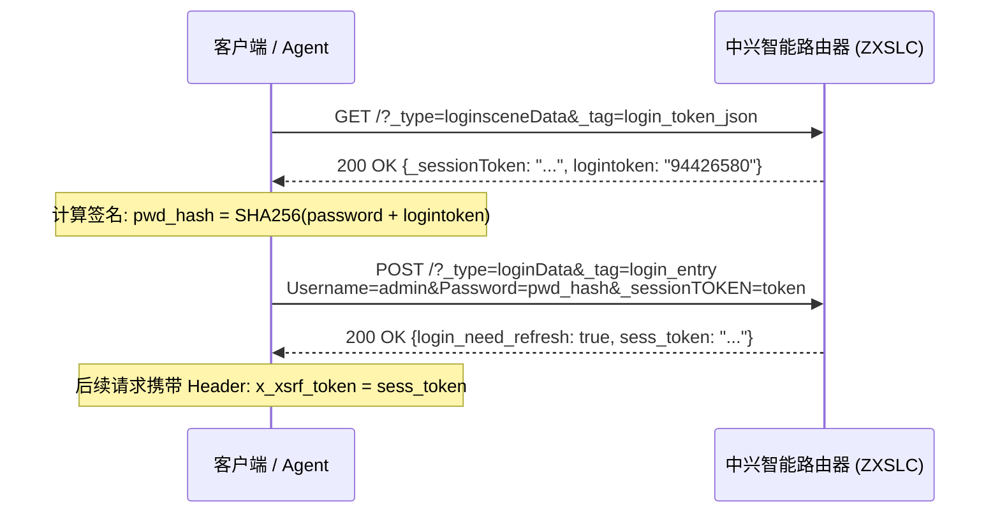

# ZTE Smart Router (ZXSLC Firmware) Reverse-Engineered API Reference

This document provides technical documentation for the REST/XML/JSON administrative API endpoints exposed by ZTE smart routers running the `ZXSLC` firmware architecture.

---

## 1. 认证机制 (Authentication Protocol)

中兴智能路由器使用两阶段动态盐值挑战认证（Dynamic Challenge-Response）：

### 流程时序图



### 关键请求参数

1. **获取 Challenge Token**：
   - `GET /?_type=loginsceneData&_tag=login_token_json`
   - 返回：
     ```json
     {
       "_sessionToken": "148333545962302525274348",
       "logintoken": "94426580"
     }
     ```
2. **计算密码签名**：
   ```python
   pwd_hash = hashlib.sha256((password + logintoken).encode('utf-8')).hexdigest()
   ```
3. **提交登录**：
   - `POST /?_type=loginData&_tag=login_entry`
   - `Content-Type: application/x-www-form-urlencoded`
   - `Headers`: `x_xsrf_token: <session_token>`, `X-Requested-With: XMLHttpRequest`
   - 表单数据：
     - `Username`: `admin`
     - `Password`: `<pwd_hash>`
     - `action`: `login`
     - `_sessionTOKEN`: `<session_token>`
   - 成功响应：
     ```json
     {
       "login_need_refresh": true,
       "sess_token": "517597557571547488777449",
       "loginErrType": ""
     }
     ```

---

## 2. 核心查询接口 (Data Query Endpoints)

所有后续数据查询接口需要在 HTTP Headers 中携带：
```http
x_xsrf_token: <sess_token>
X-Requested-With: XMLHttpRequest
Referer: http://192.168.31.1/
```

### 2.1 路由器设备信息 (`vue_dev_info_data`)
- **URL**: `GET /?_type=hiddenData&_tag=vue_dev_info_data`
- **返回格式**: XML (`ajax_response_xml_root`)
- **关键节点**: `OBJ_DEVINFO_ID -> Instance`
  - `ModelName`: 内部型号（如 `ZXSLC SR6001`）
  - `AliasName`: 产品上市名（如 `巡天青春版AX1500`）
  - `HardwareVer`: 硬件版本（如 `V1.0.0`）
  - `SoftwareVer`: 固件版本（如 `V1.0.0.3B3.8000`）
  - `SerialNumber`: 出厂序列号
  - `UpTime`: 开机运行秒数

### 2.2 局域网接入设备全量清单 (`localnet_lan_info_lua`)
- **URL**: `GET /?_type=vueData&_tag=localnet_lan_info_lua`
- **返回格式**: XML
- **关键节点**: `OBJ_LAN_INFO_ID -> Instance`
  每个设备包含一个独立的 `<Instance>` 节点：
  - `IPAddress`: 分配的局域网 IPv4 地址
  - `MACAddress`: 终端物理 MAC 地址
  - `HostName`: 终端上报的主机名（如 `DESKTOP-28AGCCU`, `worldstory`, `fengye`, `mac` 等）
  - `Active`: `1` 表示当前在线活跃；`0` 表示离线
  - `PortType` / `Port`: 接入端口类型（以太网有线口 / 2.4G Wi-Fi / 5G Wi-Fi）
  - `CurSpeed`: 当前协商协商速率

### 2.3 上行网络状态 (`vue_net_lua`)
- **URL**: `GET /?_type=vueData&_tag=vue_net_lua`
- **返回格式**: XML
- **关键节点**: `OBJ_ETHWANCPPP_ID` / `OBJ_WAN_STATUS_ID`
  - `IPAddress`: WAN 口 IP
  - `DefaultGateway`: 默认网关
  - `DNSServers`: 主备 DNS
  - `Mode`: 上网模式（DHCP / PPPoE / Static）
